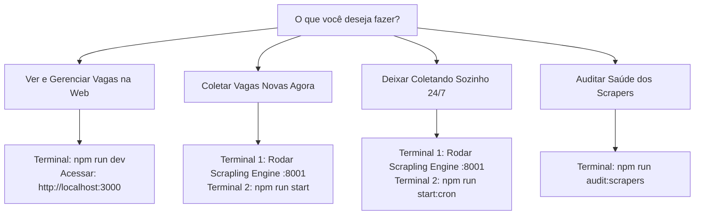

# 🚀 Guia Oficial de Comandos do Buscavag

Este documento é o manual definitivo de comandos para rodar, testar, coletar vagas e manter o ecossistema do **Buscavag** em funcionamento.

---

## ⚡ Guia Rápido: Como Rodar no Dia a Dia

Para colocar a plataforma em funcionamento completo, existem 3 passos fundamentais:

```bash
# 1. Iniciar o Microserviço Auxiliar Python (Scrapling Engine Anti-Bot na porta 8001)
# No Windows (PowerShell / CMD):
.\.venv\Scripts\python.exe -m uvicorn app.main:app --app-dir src/services/scrapling-engine --port 8001 --host 127.0.0.1

# 2. Iniciar a Aplicação Web (Next.js - Dashboard, Kanban e Vagas em http://localhost:3000)
npm run dev

# 3. Disparar uma Coleta Imediata de Vagas (Scraper em Lote Único)
npm run start
```

---

## 📖 Dicionário Completo de Comandos (`package.json`)

Abaixo está o detalhamento de cada comando configurado no projeto:

### 1. Interface Web e Aplicação Next.js

| Comando | Comando Real | O que faz e Quando Usar |
| :--- | :--- | :--- |
| `npm run dev` | `next dev` | **Inicia o servidor de desenvolvimento web** na porta `3000`. Dá acesso à interface visual do Buscavag (Dashboard de Vagas, Kanban de Candidaturas, Módulo de IA, Perfil do Usuário e API Routes). Acesse em: `http://localhost:3000`. |
| `npm run build:next` | `next build` | **Compila a aplicação Next.js para produção**, otimizando páginas, imagens, Server Components e rotas de API. |
| `npm run start:next` | `next start` | **Inicia o servidor Next.js em modo produção** (após ter executado `npm run build:next`). Ideal para deploys ou ambiente de homologação estável. |

---

### 2. Motores de Coleta (Scrapers) e Automação

| Comando | Comando Real | O que faz e Quando Usar |
| :--- | :--- | :--- |
| `npm run start` | `tsx src/index.ts` | **Executa uma rodada completa de coleta (scraping)**. Varre as fontes ativas, passa os dados pelo avaliador de IA/heurística (rejeitando vagas não-programação), deduplica por hash SHA256, salva as vagas novas no banco SQLite (`buscavag.db`) e envia notificações automáticas no Telegram configurado. |
| `npm run start:cron` | `tsx src/cron.ts` | **Inicia o agendador em segundo plano (Daemon/Cron)**. Mantém o processo rodando 24 horas por dia e dispara o pipeline de coleta periodicamente nos intervalos configurados sem necessidade de intervenção humana. |
| `npm run build` | `tsc` | Executa o compilador TypeScript (`tsc`) verificando erros de tipagem e gerando a pasta `dist/`. |
| `npm run prod` | `node dist/index.js` | Executa o pipeline de coleta a partir do código JavaScript pré-compilado na pasta `dist/`. |

---

### 3. LinkedIn Posts e Sessão Autenticada

| Comando | Comando Real | O que faz e Quando Usar |
| :--- | :--- | :--- |
| `npm run auth:linkedin` | `tsx scripts/auth-linkedin.ts` | **Valida e sincroniza a sessão do LinkedIn**. Conecta-se ao Chrome, testa o cookie de sessão (`li_at`), atualiza o arquivo `li-cookies.json` e limpa automaticamente qualquer bloqueio anterior de cooldown. |
| `npm run chrome:linkedin` | `powershell -ExecutionPolicy Bypass -File scripts/start-chrome-linkedin.ps1` | **Abre o Google Chrome dedicado na porta CDP 9222** com perfil persistente. Usado para efetuar login no LinkedIn manualmente quando necessário sem interferir no seu Chrome pessoal. |
| `npm run scrape:linkedin-posts` | `tsx src/index.ts --target "LinkedIn Posts"` | **Executa o coletor focado exclusivamente no feed e posts de recrutadores do LinkedIn**, extraindo publicações recentes com e-mails e contatos diretos. |
| `npm run test:linkedin-posts` | `tsx scripts/test-linkedin-posts.ts` | **Executa um teste isolado do coletor de posts do LinkedIn**, exibindo relatórios de interceptação de rede (API Voyager), avaliação de relevância e vagas capturadas. |

---

### 4. Diagnóstico, Auditoria e Testes de Qualidade

| Comando | Comando Real | O que faz e Quando Usar |
| :--- | :--- | :--- |
| `npm run audit:scrapers` | `tsx scripts/audit-scrapers.ts` | **Audita todas as 36 fontes de vagas em paralelo**. Gera uma tabela detalhada com tempo de resposta, volume de vagas capturadas e status de saúde (SUCCESS, WARNING ou FAILED) de cada portal. |
| `npm test` | `tsx scripts/test-runner.ts` | **Executa a suíte unificada de testes do Buscavag** (10 suítes completas: banco de dados, Kanban, RBAC, autenticação, parser, resiliência e blindagem anti-ruído). |
| `npm run test:base` | `tsx src/test-phase1.ts` | Testa a integridade estrutural das tabelas SQLite e operações de inserção/consulta do banco. |
| `npm run test:phase8` | `tsx src/test-phase8.ts` | Testa as operações de transição de status do Kanban e agregação de métricas analíticas. |
| `npm run test:whatsapp` | `tsx src/test-whatsapp.ts` | Testa o extrator de vagas para mensagens e grupos de WhatsApp. |
| `npm run test:fb` | `tsx scripts/test-facebook-groups.ts` | Testa o coletor de postagens em grupos públicos de programadores no Facebook. |

---

### 5. Limpeza e Resolução de Portas Travadas

| Comando | O que faz |
| :--- | :--- |
| `npm run clean:ports` | Libera a porta 3000 caso tenha ficado presa por uma instância zumbi do Next.js. |
| `npm run kill:zombies` | Finaliza processos órfãos de Node/TSX que possam estar ocupando memória em segundo plano. |
| `npm run clean:all` | Executa a limpeza combinada de processos zumbis e liberação da porta 3000. |

---

## 🛠️ Comandos Adicionais & Scripts Especiais

### Coleta de uma Única Fonte Específica
Se você quiser rodar o scraper para **apenas uma fonte** (por exemplo, só Gupy ou só InfoJobs), passe o argumento `--target`:

```bash
# Apenas Gupy
npx tsx src/index.ts --target "Gupy"

# Apenas Glassdoor
npx tsx src/index.ts --target "Glassdoor"

# Apenas Trabalha Brasil
npx tsx src/index.ts --target "Trabalha Brasil"

# Apenas BNE
npx tsx src/index.ts --target "BNE"
```

---

### Higienização do Banco de Dados (Apenas Vagas de Programação)
Para reavaliar todas as vagas gravadas no banco de dados e arquivar/ocultar qualquer vaga que não seja estritamente de programação (removendo suporte, consultoria SAP funcional, redes, etc.):

```bash
npx tsx scripts/sanitize-db-programming.ts
```

---

### Verificação Rápida de Tipagem (TypeScript)
Para ter certeza de que nenhuma alteração de código quebrou tipos no projeto:

```bash
npx tsc --noEmit
```

---

## 🐍 Microserviço Scrapling Engine (Python)

Algumas fontes (como o **Glassdoor**) utilizam proteção avançada da Cloudflare e necessitam do microserviço Python de evasão TLS.

### Como Iniciar o Scrapling Engine:
- **No Windows:**
  ```powershell
  .\.venv\Scripts\python.exe -m uvicorn app.main:app --app-dir src/services/scrapling-engine --port 8001 --host 127.0.0.1
  ```
- **No Linux / macOS:**
  ```bash
  ./.venv/bin/python -m uvicorn app.main:app --app-dir src/services/scrapling-engine --port 8001 --host 127.0.0.1
  ```

### Como Testar a Saúde do Motor Python:
Abra o navegador ou use curl em:  
👉 `http://127.0.0.1:8001/health`  
Retorno esperado: `{"status": "healthy", "version": "1.1.0", ...}`

---

## 📋 Resumo dos Cenários de Uso


